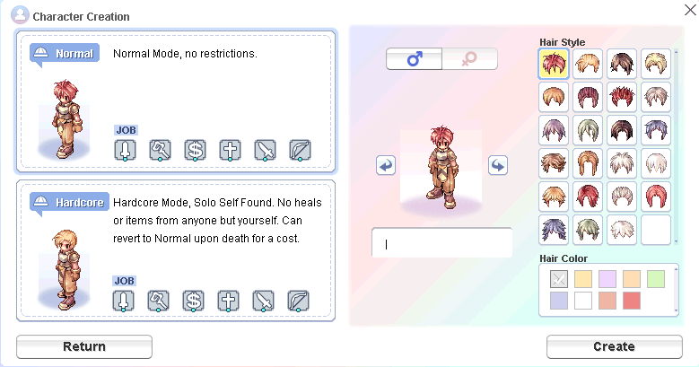

# RO Systems I: Character

## Your Character

The first thing you'll do after logging in for the first time is create a character. The character creation screen gives you five options:

  

* **Name**: Your character's name. Every character has a unique name, which appears whenever you talk in chat and when someone hovers the cursor over your character. A character name **can't** be changed later, so choose carefully.
* **Sex**: Male or Female. This choice applies to each character individually, so you can have both male and female characters on the same account.
* **Hair style**: Your character's starting hair style. You can change it for free at any time at the Prontera Main Office, which also offers additional styles.
* **Hair color**: Your character's starting hair color. Like the hair style, you can change it for free at any time at the Prontera Main Office, which also offers additional colors.
* **Difficulty**: In SpringRO, you can choose to play with a normal Ragnarok Online character or a Hardcore one. Hardcore characters are meant to be played solo, and can't trade with other players or join parties.

>[!TIP]
> Sex is mostly cosmetic, but one of the Archer's second jobs depends on it. Male Archers can become Bards, while female Archers can become Dancers. These classes have different skills, so if you're interested in either, choose your character's sex accordingly.

## Base Level & Job Level

Every character has two levels: **Base Level** and **Job Level**. Both increase by earning experience points (EXP) from defeating monsters and completing quests. Each level type has its own independent progress bar, and every EXP source gives different amounts of **Base EXP** and **Job EXP**. All new characters start with the Novice job and Base and Job Levels of 1.

### Base Level

Represents your character's main level and goes from 1 to 99. For every Base Level, a character gains the following:

* Points to allocate in their stats.
* Increased Health Points (HP) and Spiritual Points (SP).

Each time a character dies, it loses 1% of its Base Level progression, regardless of the amount. Therefore, the higher the level the more EXP a character

> [!TIP]
> The Base Level is the one used for item and quest Level requirement.

### Job Level

Represents your character's mastery of their current job and goes up to 50 for all jobs except Novice, which caps at Job Level 10.

## Jobs
