# RO Systems I: Character

## Your Character

The first thing you'll do after logging in for the first time is create a character. The character creation screen gives you five options:

  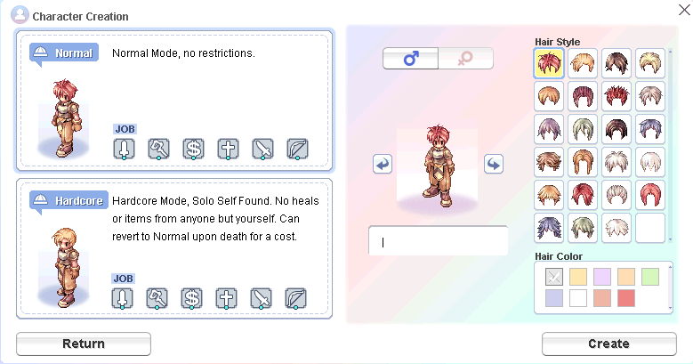

* **Name**: Your character's name. Every character has a unique name, which appears whenever you talk in chat and when someone hovers the cursor over your character. A character name **can't** be changed later, so choose carefully.
* **Sex**: Male or Female. This choice applies to each character individually, so you can have both male and female characters on the same account.
* **Hair style**: Your character's starting hair style. You can change it for free at any time at the Prontera Main Office, which also offers additional styles.
* **Hair color**: Your character's starting hair color. Like the hair style, you can change it for free at any time at the Prontera Main Office, which also offers additional colors.
* **Difficulty**: In SpringRO, you can choose to play with a normal Ragnarok Online character or a Hardcore one. Hardcore characters are meant to be played solo, and can't trade with other players or join parties.

> **💡TIP:**
> Sex is mostly cosmetic, but one of the Archer's second jobs depends on it. Male Archers can become Bards, while female Archers can become Dancers. These classes have different skills, so if you're interested in either, choose your character's sex accordingly.

## Base Level & Job Level

Every character has two levels: **Base Level** and **Job Level**. Both increase by earning experience points (EXP) from defeating monsters and completing quests. Each level type has its own independent progress bar, and every EXP source gives different amounts of **Base EXP** and **Job EXP**.

  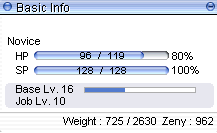

### Base Level

Represents your character's main level and goes from 1 to 99. For every Base Level, a character gains the following:

* Points to allocate in their stats.
* Increased Health Points (HP) and Spell Points (SP).
* Full HP & SP heal, immediately after leveling up.
* +1 HIT & +1 FLEE.

Each time a character dies, it loses 1% of its Base Level progressions. This means that the higher the level a character is when they die, the more EXP they lose.

> **💡TIP:**
> The Base Level is the one used for items and quests Level requirements.

### Job Level

Represents your character's mastery of their current job and goes from level 1 up to 50 for all first and second jobs, while capping at level 10 for the Novice job.

For every Job Level, a character gains 1 Skill point that can be used to Level Up a Skill.

Additionally, on specific levels, Jobs receive a +1 bonus to a stat. The stat gain is fixed  and depends on both Job and Job Level.

Once a **First Job** reaches Job Level 40, it can change to a **Second Job** of their class.

> **💡TIP:**
> While you can change at Job Level 40, it's usually recommended to change at Job Level 50 (the cap), in order to get all the available Skill Points. Besides the extra time investment, there's no downside to change Jobs at Job Level 50.

Every time you get a Job change, your Job Level will be set to Level 1, and you will unlock a new Skill Tree. 

## Jobs

In Ragnarok Online, **all characters** start with the Novice job and Base and Job Levels of 1.

After reaching Job Level 10 and maxing the Basic Skill ability, a Novice is able to choose a **First Job**, which also determines their **Class**.

#### Male

| 1st Job (Class) | 2nd Job (2-1) | 2nd Job (2-2) |
|:-------:|:-------:|:-------:|
| 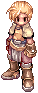 Swordsman | 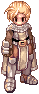 Knight | 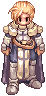 Crusader |
| 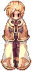 Mage | 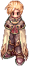 Wizard | 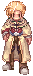 Sage |
| 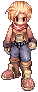 Archer | 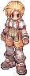 Hunter | 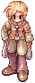 Bard |

| 1st Job (Class) | 2nd Job (2-1) | 2nd Job (2-2) |
|:-------:|:-------:|:-------:|
| 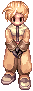 Acolyte | 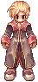 Priest | 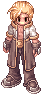 Monk |
| 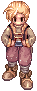 Merchant | 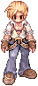 Blacksmith | 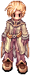 Alchemist |
| 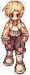 Thief | 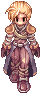 Assassin | 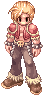 Rogue |

#### Female

| 1st Job (Class) | 2nd Job (2-1) | 2nd Job (2-2) |
|:-------:|:-------:|:-------:|
| 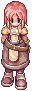 Swordsman | 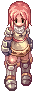 Knight | 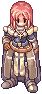 Crusader |
| 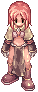 Mage | 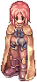 Wizard | 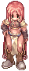 Sage |
| 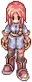 Archer | 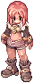 Hunter | 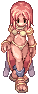 Dancer |

| 1st Job (Class) | 2nd Job (2-1) | 2nd Job (2-2) |
|:-------:|:-------:|:-------:|
| 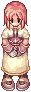 Acolyte | 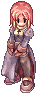 Priest | 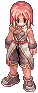 Monk |
| 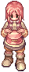 Merchant | 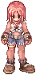 Blacksmith | 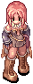 Alchemist |
| 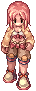 Thief | 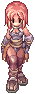 Assassin | 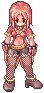 Rogue |

<!-- TODO: Add Expanded classes when they are implemented.-->

---

[Index](README.md) \| [II: Stats →](ro-systems-2-stats.md)

